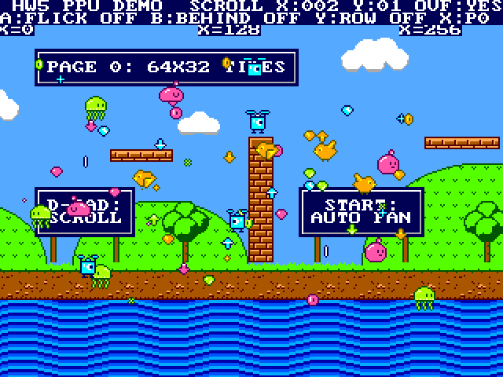
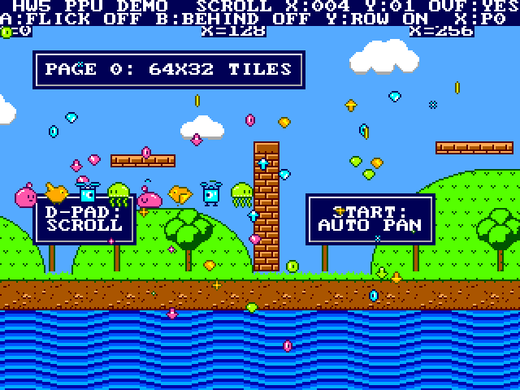
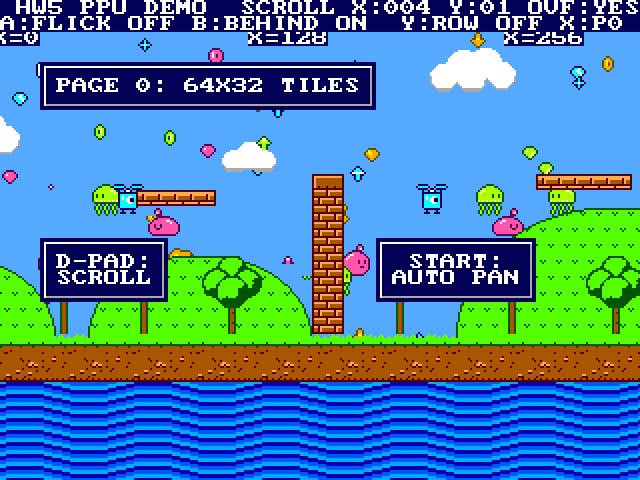

# PPU (FPGA, pure Verilog)

A 3rd-generation-console-style PPU (picture processing unit) in plain
Verilog, plus a demo program that shows off every feature. No CPU, no
software, no frame buffer.

Course project 5 of 2110597 Graphics System Architecture, Chulalongkorn
University.

**Run it:** [open in the VGA Playground](https://vga-playground.com/?repo=https://github.com/xHexlabx/fpga-ppu),
then turn on Gamepad mode.

A game built on this same PPU, file for file:
[fpga-game-ppu](https://github.com/xHexlabx/fpga-game-ppu).



## What the PPU is

The PPU draws the picture and knows nothing about the game. The game ("the
CPU side") only ever writes PPU memory through one write port, one 32-bit word
per clock, plus a read port into the tile map. That is how a console CPU talks
to its PPU through registers, and it is the split this project is about.

```
                 write port (we, addr, data)            pattern bus
  demo_cpu.v  ------------------------------>  ppu.v  -------------->  chr_rom.v
  (the program)   <-- VRAM read, frame_start --  (draws)  <-- tile rows --  (cartridge ROMs)
                                                   |
                                                   v
                                              640x480 VGA
```

| Feature | Detail |
| --- | --- |
| Resolution | 320x240, each pixel a 2x2 block on 640x480@60 VGA (25.175 MHz) |
| Colours | RGB222: 6 bits, so a 64-colour master palette (the NES also had 64) |
| Palette RAM | 32 entries: 4 background + 4 sprite palettes of 4 colours. Colour index 0 is transparent everywhere; the backdrop is entry 0 |
| Background | 2 VRAM pages, each 64x32 tiles of 8x8 px (512x256 px). Map entry = {palette, tile}. Tiles are 2 bits per pixel, 256 of them in the cartridge's background pattern ROM |
| Scrolling | X/Y scroll registers with wrap-around, plus page select |
| Split screen | two scroll registers, A above line `split`, B below. A fixed HUD over a scrolling playfield, with no mid-frame CPU tricks |
| Sprites | 64-entry OAM. Each sprite: x, y, tile, palette, H-flip, V-flip, behind-background priority, 8x8 or 16x16 |
| Per-line limit | the PPU evaluates OAM for each line and keeps the first 8 sprites. A 9th sets the overflow flag and is not drawn, as on real hardware |
| Priority | lower OAM index on top; a "behind" sprite shows only where the background is transparent |
| Frame buffer | none: a double line buffer of 2x320 pixels |

### How a line is drawn

While one logical line is on screen (two VGA lines, 1600 clocks), the PPU
builds the next one in the other half of the line buffer, in three passes:

1. **Sprite evaluation** (64 clocks). One OAM entry per clock: does the sprite
   cross this line? The first 8 go into an 8-entry secondary OAM, with the row
   inside the sprite already worked out (V-flip applied here).
2. **Background** (320 clocks). A 3-stage pipeline, one pixel per clock:
   VRAM read (which tile?), pattern ROM read (which colour index?), palette
   RAM read, then a write into the line buffer. A second bit array remembers
   where the background was opaque, for the "behind" bit.
3. **Sprites** (up to 8 x 16 clocks). The selected sprites are painted from
   the 8th back to the 1st, so the 1st ends up on top. A sprite pixel is
   written only if it is opaque and not (behind and over opaque background).

Worst case is about 530 clocks, a third of the time available. Scan-out just
reads the other half of the line buffer at `x/2`.

### Memory map of the write port

| Address | What | Data |
| --- | --- | --- |
| `0x0000-0x0FFF` | VRAM: page = a[11], row = a[10:6], column = a[5:0] | `{palette[1:0], tile[7:0]}` |
| `0x1000-0x103F` | OAM, one sprite per address | `[8:0]` x, `[16:9]` y, `[24:17]` tile, `[26:25]` palette, `[27]` H-flip, `[28]` V-flip, `[29]` behind, `[30]` 16x16 |
| `0x1040-0x105F` | palette RAM | `[5:0]` colour |
| `0x1060` / `0x1061` | scroll A / scroll B | `{page, y[7:0], x[8:0]}` |
| `0x1062` | split line | lines above it use scroll A |
| `0x1063` | control | bit 0 display, bit 1 background, bit 2 sprites |

The PPU also outputs `frame_start` (a pulse when vertical blank begins, so the
game knows when to update), `vblank` and `sprite_overflow`.

## The demo program

`demo_cpu.v` is what a demo cartridge's CPU program would do, built as a
hardwired sequencer. At power-on it copies the tile map (`demo_map.mem`) into
VRAM and the palette (`palette.mem`) into palette RAM. Then, once per frame in
vertical blank, it reads the pad, moves the camera, moves 64 objects and writes
them to OAM, colour-cycles the water, updates the HUD text and writes the
scroll and split registers. That is about 90 clocks per frame.

Objects 0-15 are 16x16 creatures, 16-63 are 8x8 items. They bounce around at
different speeds, so some lines cross more than 8 of them.

### Controls

In the playground, turn on **Gamepad** mode (keys: arrows, `a`, `b`, `x`, `y`,
`s` = select, `t` = start).

| Button | What it shows |
| --- | --- |
| D-pad | scroll the 512x256 world in X and Y (it wraps) |
| A | **FLICK**: rotate the OAM order each frame, so the sprites dropped by the 8-per-line limit change every frame (they flicker instead of vanishing) |
| B | **BEHIND**: every sprite goes behind opaque background |
| Y | **ROW**: line up the 16 creatures on one row. 16 sprites on a line, so 8 vanish and the HUD shows `OVF:YES` |
| X | rotate the sprite palettes (same tiles, other colours) |
| Select | HUD split on/off |
| Start | auto pan on/off (on at power-up) |

Without Gamepad mode the `ui_in` switches work too. The playground's buttons
are toggles, so each one counts as held while it is on: `ui_in[0..3]` =
up/down/left/right, `ui_in[7]` = ROW.

## Files

| File | What |
| --- | --- |
| `info.yaml` | what the VGA Playground loads |
| `src/ppu.v` | the PPU |
| `src/vga_timing.v` | 640x480@60 timing (from project 4) |
| `src/chr_rom.v` | the cartridge's two pattern ROMs |
| `src/demo_cpu.v` | the demo program |
| `src/tt_um_hextex_ppu_demo.v` | Tiny Tapeout / playground top |
| `src/gamepad_pmod_rx.v` | Gamepad Pmod receiver (from project 4) |
| `src/*.mem` | cartridge data, made by `scripts/gen_assets.py` |
| `scripts/gen_assets.py` | draws the tiles, sprites and world map; all art is original |
| `sim/` | testbenches, see below |

## Verification

Icarus Verilog, Python 3 with numpy and Pillow.

```sh
sh sim/run_ppu_tests.sh            # the PPU alone vs a Python golden model
cd src
iverilog -g2005 -o ../sim/out/tb_demo.vvp ../sim/tb_demo.v tt_um_hextex_ppu_demo.v \
         demo_cpu.v ppu.v vga_timing.v chr_rom.v gamepad_pmod_rx.v
vvp ../sim/out/tb_demo.vvp         # the whole demo, driven like the playground
python3 ../sim/check_demo.py       # each captured frame vs the golden model
python3 ../sim/frames_to_png.py    # frames as PNGs in sim/out/
```

- **PPU vs golden model** (`tb_ppu.v`, `ppu_model.py`): 14 frames, random and
  directed. They cover sprites wrapping in at the left and top edges and
  clipped at the right; 9 to 16 sprites on a line; flips on both sizes; 16x16
  tile addressing past tile 255; "behind" over opaque and transparent
  background; split at 0, 240 and mid-screen with different pages; scroll
  wrap; background, sprites or display switched off. Every pixel and the
  overflow flag match. Also checked: sync widths, `de` exactly 640x480, every
  line build back to idle before the next one. The worst case is 516 clocks
  of the 1600 available.
- **The whole demo** (`tb_demo.v`): driven through the Gamepad Pmod protocol
  the way the playground drives it. Every button toggles exactly its setting;
  the d-pad and the `ui_in` switches scroll; ROW raises the overflow flag; with
  FLICK on, the row of creatures changes frame to frame; sync widths and no
  unknown values on the pins. Each of the 8 captured frames, read off the
  Tiny VGA pins, matches the golden model rendering the PPU state of that
  frame, pixel for pixel, with the real tiles.
- **Verilator 5.054** with the playground's flags: no errors (only the two
  `PROCASSINIT` warnings in `vga_timing.v` that project 4 already has).

| Default | ROW: 16 on a line, 8 drawn | BEHIND |
| --- | --- | --- |
|  |  |  |
